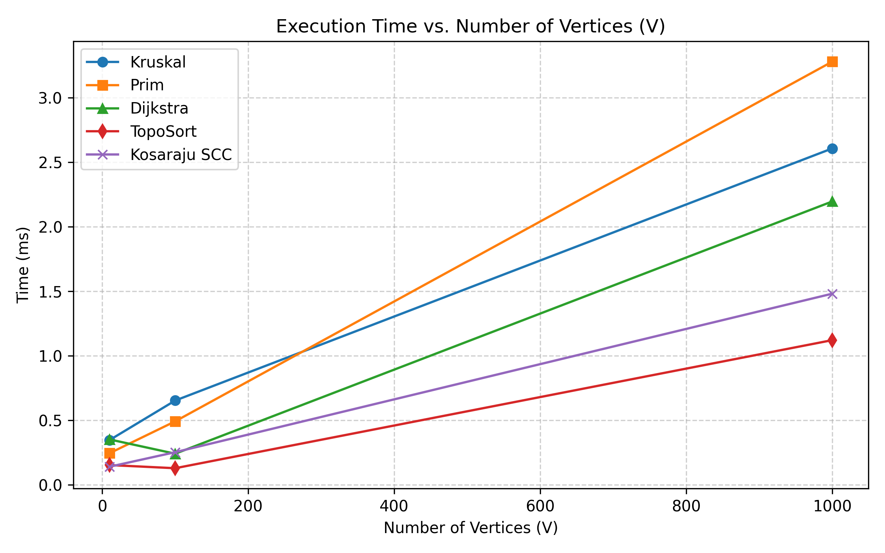
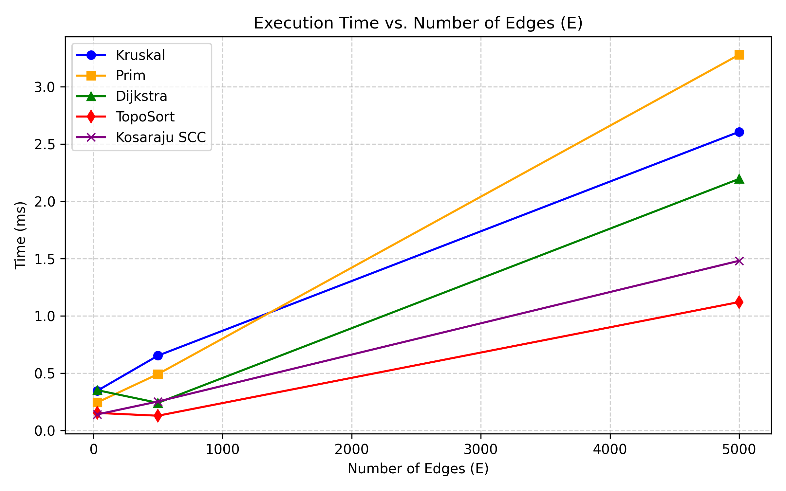
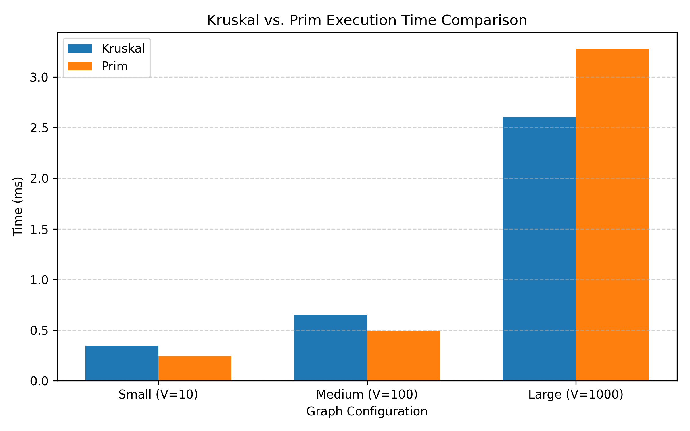
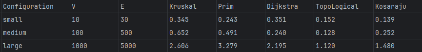

# Assignment 3: Smart City Route Planning and Graph Algorithms

**Made by Alimkhanov Aldiyar**

---

## 1. Project Overview

This project implements fundamental graph algorithms in Java for road and network planning in a smart city:
* **Minimum Spanning Tree (MST):** Kruskal's algorithm (with a custom DSU / Union-Find) and Prim's algorithm (using a Priority Queue) to connect all city districts with the minimum cost.
* **Connectivity & Order:** Topological Sort (Kahn's algorithm) to find a valid task order and detect cycles, and Kosaraju's algorithm to find Strongly Connected Components (SCC).
* **Shortest Path:** Dijkstra's algorithm to find the quickest route between locations and reconstruct the full path.

---

## 2. Complexity Analysis

### DSU (Disjoint Set Union)
* **How it works:** Keeps track of connected elements using an array. It uses **Path Compression** (pointing nodes directly to the root during `find`) and **Union by Rank** (attaching the smaller tree under the larger tree during `union`).
* **Time Complexity:** Almost O(1) (constant time) for both `find` and `union`. Technically it is O(alpha(V)), where alpha is the inverse Ackermann function, which never exceeds 4 in the real world.
* **Space Complexity:** O(V) to store `parent` and `rank` arrays.
* **Impact of V and E:** The number of vertices V sets the size of arrays. The number of edges E determines how many times we call `find` and `union`. Because the operations are nearly instantaneous, DSU never slows down the program.

---

### Kruskal's Algorithm
* **Assumptions:** Edges are stored in a simple list. We sort all edges by weight and use our DSU to avoid cycles.
* **Time Complexity:** O(E log E) or O(E log V).
* **Space Complexity:** O(V + E) to store the list of edges and the DSU.
* **Impact of V and E:** The slowest part of Kruskal's algorithm is sorting the edges. If a graph has a lot of edges (dense graph), sorting takes more time. When edges are sparse (E is close to V), Kruskal runs very fast. It stops early as soon as it picks V - 1 edges.

---

### Prim's Algorithm
* **Assumptions:** The graph uses an adjacency list. We use Java's `PriorityQueue` (binary min-heap) to always pick the cheapest available edge.
* **Time Complexity:** O((V + E) log V).
* **Space Complexity:** O(V + E) for the adjacency list, the visited array, and the priority queue.
* **Impact of V and E:** Every time we discover a new road, we push it into the priority queue, which takes log time. If the graph has many edges, the priority queue grows large, making pushes and polls slower. For sparse graphs, it stays small and runs fast.

---

### Strongly Connected Components (Kosaraju's Algorithm)
* **Assumptions:** Uses an adjacency list. We run Depth-First Search (DFS) twice and invert all edge directions in between.
* **Time Complexity:** O(V + E).
* **Space Complexity:** O(V + E) to store the original graph, the reversed graph, and the visited arrays.
* **Impact of V and E:** This algorithm is strictly linear. It visits every vertex and every edge a constant number of times. Neither edge weights nor cycles slow it down.

---

### Topological Sort (Kahn's Algorithm)
* **Assumptions:** Uses an adjacency list, an array to count incoming edges (in-degree), and a queue (`ArrayDeque`).
* **Time Complexity:** O(V + E).
* **Space Complexity:** O(V + E) for the in-degree array and the queue.
* **Impact of V and E:** It processes each node and each edge once. If there is a cycle, the queue empties before all vertices are visited, so cycle detection is done with a simple check in O(1) time at the end.

---

### Dijkstra's Algorithm
* **Assumptions:** Uses an adjacency list and a `PriorityQueue`. All edge weights must be zero or positive.
* **Time Complexity:** O((V + E) log V).
* **Space Complexity:** O(V + E) to store distances, parents for path reconstruction, and the priority queue.
* **Impact of V and E:** Each node is popped from the queue, and each edge is checked. When a shorter path is found, a new distance is pushed into the queue. More edges mean more queue operations.

---

### Why Dijkstra Fails with Negative Weights
Dijkstra is a **greedy** algorithm. Once it removes a vertex from the priority queue, it marks it as visited and assumes the shortest path to this vertex is final.

If a graph contains a negative edge, a longer-looking path could later become shorter by adding that negative number. Dijkstra will not notice this because it never re-checks finished vertices. If there is a negative cycle, the path weight could decrease infinitely.

---

### Summary Table

| Algorithm | Data Structure | Time Complexity | Space Complexity | Main Bottleneck |
| :--- | :--- | :--- | :--- | :--- |
| **DSU** | Arrays (`parent`, `rank`) | O(1) amortized | O(V) | Tree lookups |
| **Kruskal** | Edge List + DSU | O(E log V) | O(V + E) | Sorting edges |
| **Prim** | Adjacency List + Min-Heap | O((V + E) log V) | O(V + E) | Priority Queue operations |
| **Kosaraju SCC** | Adjacency List | O(V + E) | O(V + E) | Two DFS passes |
| **Topological Sort** | Adjacency List + Queue | O(V + E) | O(V + E) | Checking incoming edges |
| **Dijkstra** | Adjacency List + Min-Heap | O((V + E) log V) | O(V + E) | Updating queue on relaxations |

---

## 3. Experimental Analysis

We tested all algorithms on three different graph sizes with random seed `42` to ensure reproducible results. Each test was repeated 5 times, and the average time was recorded using `System.nanoTime()`.

### Configurations
* **Small:** V = 10, E = 30
* **Medium:** V = 100, E = 500
* **Large:** V = 1000, E = 5000

### Benchmark Results (Average Execution Time in ms)

| Configuration | Vertices (V) | Edges (E) | Kruskal (ms) | Prim (ms) | Dijkstra (ms) | TopoSort (ms) | Kosaraju SCC (ms) |
| :--- | :--- | :--- | :--- | :--- | :--- | :--- | :--- |
| **Small** | 10 | 30 | 0.345 | 0.243 | 0.351 | 0.152 | 0.139 |
| **Medium** | 100 | 500 | 0.652 | 0.491 | 0.240 | 0.128 | 0.252 |
| **Large** | 1000 | 5000 | 2.606 | 3.279 | 2.195 | 1.120 | 1.480 |

### Plots
* **Execution Time vs Number of Vertices:**  

* **Execution Time vs Number of Edges:**  

* **Kruskal vs Prim Comparison:**  

### Tables

---

## 4. Discussion of Results

1. **Kruskal vs. Prim:**
    * On small and medium graphs, Prim's algorithm was slightly faster than Kruskal.
    * On the large graph (V = 1000, E = 5000), Kruskal became faster (2.60 ms vs 3.28 ms). This happens because our DSU is extremely fast, while Prim's priority queue has to handle thousands of edge insertions.
2. **Linear Algorithms:**
    * Topological Sort and Kosaraju's SCC were the fastest algorithms across all sizes (around 1.1–1.5 ms on the large graph). This confirms their linear O(V + E) complexity.
3. **JVM Warmup Effect:**
    * On the small graph, Dijkstra took 0.351 ms, but on the medium graph it took 0.240 ms. This is a normal Java behavior called JIT (Just-In-Time) compilation: Java runs a bit slower on the first calls while loading classes, and speeds up as code gets compiled into machine code.

---

## 5. Verification and Edge Cases

All edge cases were tested in `src/Testing.java` without external libraries:
* **Single vertex graph:** Handled correctly (MST is empty, distance to self is 0, forms 1 SCC).
* **Disconnected graph:** Detected successfully (MST has fewer than V - 1 edges).
* **Equal weights:** Kruskal and Prim produced the exact same total weight.
* **Cycles in DAG:** Topological sort detected cycles and returned `null`.
* **Unreachable vertices:** Dijkstra correctly returned `Integer.MAX_VALUE` and an empty path.